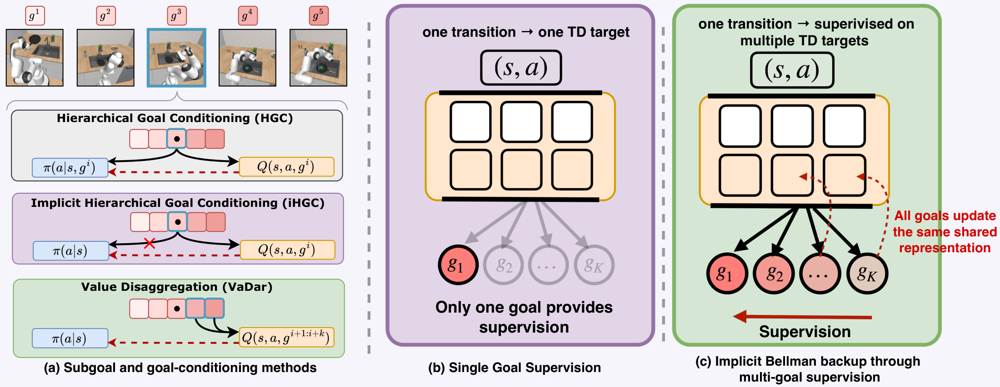
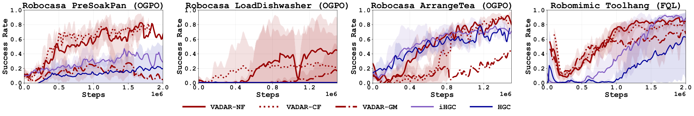
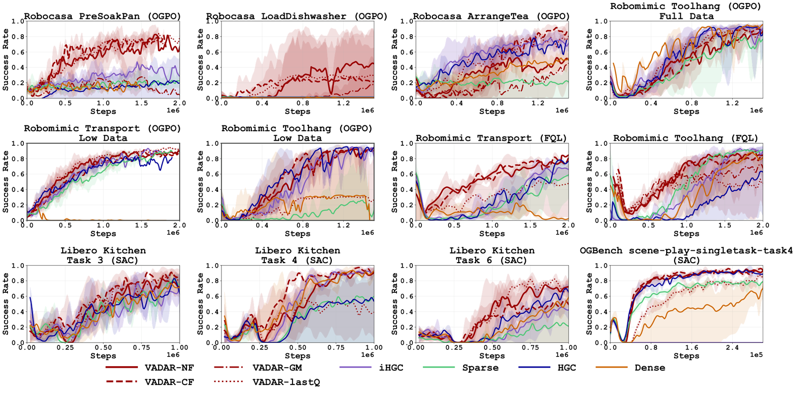

<div align="center">


# VaDaR: Implicit Goal Conditioning via Value Disaggregation

[](https://simchowitzlabpublic.github.io/vadar-site/)
[](pyproject.toml)
[](https://github.com/google/flax)
[](https://docs.astral.sh/uv/)

Shashwat Saxena\*, Mehul Goel\*, Sreyas Venkataraman\*, Sarvesh Patil, Max Simchowitz<br>
Carnegie Mellon University · \*Equal contribution

[Overview](#overview) · [Getting started](#getting-started) · [Running VaDaR](#running-vadar) · [Reproducing the paper](#reproducing-the-paper) · [Repository layout](#repository-layout)

</div>

Long-horizon robot tasks come with natural subgoals: grasp the pan, put it in the sink,
turn on the water. **VaDaR** uses them to learn a better critic instead of a
goal-conditioned policy. One shared critic predicts the return for **every** subgoal from
every transition, and a single subgoal-agnostic policy is trained on a weighted sum of
those values. Subgoal information is used only during training, so the deployed policy
needs no subgoal detection.

This repository contains VaDaR on top of three base algorithms (OGPO, FQL and SAC), every
baseline from the paper, and launchers for all experiments.

## Overview

<p align="center">
  
</p>

VaDaR changes a value-based RL algorithm in three places:

1. **All-subgoal critic.** The critic predicts Q(s, a, g) for every subgoal g. Each
   subgoal gets its own TD target from the subgoal-completion vector d, with
   r[g] = +5 once g is done and -1 otherwise, and targets clipped at 15.
2. **Weighted policy extraction.** The policy maximizes
   `Q_agg(s, a) = sum_g w(d)[g] * Q(s, a, g)`. The default *next-future* weighting
   counts every subgoal after the current one, so the policy is rewarded for completing
   the current subgoal in a way that helps the rest of the task.
3. **Subgoal-agnostic policy.** π(a | s) never sees subgoal information.

<p align="center">
  
</p>

Goal topologies with parallel branches (robomimic transport, RoboCasa LoadDishwasher)
use the DAG version of the weightings.

### Results

<p align="center">
  
</p>

- VaDaR improves OGPO, FQL and SAC, with the largest gains on the longest tasks. On
  RoboCasa it is the only method that learns LoadDishwasher, and it reaches nearly twice
  the success of the strongest baseline on PreSoakPan.
- With a frozen behavior-cloned policy, best-of-4 steering with a VaDaR critic raises
  success from 23% to 55% on ArrangeTea and from 32% to 77% on ToolHang (the sparse
  critic: 23% and 44%).
- VaDaR Last-Q, which trains on all subgoals but extracts the policy from the final
  subgoal only, already beats the sparse baseline. Dense subgoal supervision improves the
  critic itself.

## Getting started

### Prerequisites

- Linux with an NVIDIA GPU (CUDA 12 or 13); Python 3.11 or 3.12
- [uv](https://docs.astral.sh/uv/getting-started/installation/) and the
  [GitHub CLI](https://cli.github.com/) (`gh auth login`) for the datasets
- About 30 GB of disk for the environments and the RoboCasa kitchen assets

### 1. Build the environments

```bash
git clone https://github.com/simchowitzlabpublic/vadar-public.git
cd vadar-public
bash scripts/setup_env.sh          # .venv (robomimic, RoboCasa, OGBench, PushT) and .venv-libero
```

`setup_env.sh` runs `uv sync` against the pinned `uv.lock`, downloads the RoboCasa kitchen
assets (about 20 GB), and configures LIBERO. Useful variables:

| Variable | Purpose |
|---|---|
| `CUDA=cuda13` | use CUDA 13 JAX wheels (default `cuda12`) |
| `VADAR_VENV`, `VADAR_VENV_LIBERO` | where to put the two environments |
| `ROBOCASA_ASSETS=/path/to/assets` | link existing RoboCasa assets instead of downloading them |
| `UV_CACHE_DIR` | keep the uv cache on scratch storage |

> [!NOTE]
> LIBERO needs robosuite 1.4 while RoboCasa and robomimic need robosuite 1.5 with
> MuJoCo 3.3.1, so LIBERO runs use the separate `.venv-libero` environment. Build only
> one with `bash scripts/setup_env.sh main` or `bash scripts/setup_env.sh libero`.

### 2. Download the datasets

```bash
bash scripts/fetch_datasets.sh     # -> data/{robomimic,robocasa,libero,pusht,ogbench}
```

### 3. Check the install

```bash
.venv/bin/python -m pytest tests/  # weightings, targets, critics, every agent, the online runner (CPU)
```

## Running VaDaR

`vadar/main.py` is the single entry point; any yaml key can be overridden as
`--section.key=value`.

```bash
source .venv/bin/activate
export MUJOCO_GL=egl PYTHONPATH=$PWD

# OGPO + VaDaR (next-future weighting, Q(s,a,g) critic) on robomimic tool_hang
python vadar/main.py --algo=ogpo_vadar --env.name=tool_hang-ph-low_dim --agent.horizon_length=8

# FQL + VaDaR with the vector-valued critic and current-future weighting on transport
python vadar/main.py --algo=fql_vadar --env.name=transport-mh-low_dim --agent.vadar_critic=vector --agent.weighting=CF

# OGPO + VaDaR on RoboCasa PreSoakPan (RoboCasa runs reset to a fixed demo layout)
python vadar/main.py --algo=ogpo_vadar --env.name=robocasa_PreSoakPan --env.anchor_demo=demo_0
```

### Agents

Each base algorithm has a sparse-reward agent and a VaDaR twin that differs from it only
by the VaDaR changes (`diff vadar/agents/ogpo.py vadar/agents/ogpo_vadar.py`).

| Base algorithm | Sparse reward | VaDaR |
|---|---|---|
| [OGPO](https://simchowitzlabpublic.github.io/ogpo-site/) | `--algo=ogpo` | `--algo=ogpo_vadar` |
| FQL (OGPO's one-step mode) | `--algo=fql` | `--algo=fql_vadar` |
| SAC | `--algo=sac` | `--algo=sac_vadar` |

### VaDaR options (`--agent.*`)

| Option | Values |
|---|---|
| `weighting` | `next_future` / `NF` (default), `current_future` / `CF`, `current_myopic` / `GM`, `next_myopic` / `NM`, `last` (VaDaR Last-Q), `constant` |
| `vadar_critic` | `goal_conditioned`: Q(s,a,g) (default), `vector`: Vector-VaDaR, `separate`: per-subgoal critics; MIQ via `use_mip_q=true` |
| `td_target` | `gated` (the paper's runs) or `clipped` |
| `use_subgoal_discounts` | per-subgoal discounts from `envs/subgoals.py` |
| `use_subgoal_dag` | DAG weightings for transport and LoadDishwasher |

### Baselines

| Paper | Flags (on the sparse agent unless noted) |
|---|---|
| Sparse | none |
| HGC | `--env.goal_obs=cumulative --env.reward_mode=hgc --agent.goal_conditioned_actor=true --agent.goal_conditioned_critic=true` |
| iHGC | HGC with `--agent.goal_conditioned_actor=false` |
| Steelman 1/2/3 | VaDaR agent + `--env.goal_obs=cumulative --agent.goal_conditioned_actor=true --agent.goal_conditioned_critic=false`, weighting GM / CF / NF |
| VaDaR-Shaped | `--env.reward_mode=shaped` |
| Dense (preference reward) | `--reward_model.baseline=dense` |
| Pref-Subgoal | `--reward_model.baseline=pref_subgoal` |
| HER | `--env.goal_obs=state` (or `latent`) plus the `her_*` keys; see `scripts/paper/methods/her.sh` |
| PushT-Obs (multi-objective) | `sac_vadar` with a task head and a cost head; aggSAC is `sac` with `--env.reward_mode=dense_parity` |

> [!TIP]
> `docs/DESIGN.md` maps every paper name to its config and explains the environment
> contract (`info['subgoal_dones']` and the offline `subgoal_dones` labels).

## Reproducing the paper

`scripts/paper/launch.sh <task> <method>` reproduces any run with the hyperparameters the
paper used; `scripts/paper/README.md` maps each figure and table to its commands.

```bash
# VaDaR-NF on RoboCasa PreSoakPan, three seeds on SLURM
sbatch --array=1-3 scripts/paper/launch.sh presoakpan_ogpo vadar_nf

# print the command instead of running it
DRY_RUN=1 bash scripts/paper/launch.sh toolhang_fql ihgc
```

Also included: the PushT-Obs λ sweep (`scripts/paper/sweep_pusht_lambda.sh`), the MIQ
update-to-data sweep (`scripts/paper/sweep_miq_utd.sh`) and frozen-policy steering
(`scripts/paper/steering.sh`, `scripts/steering/steering_eval.py`).

> [!IMPORTANT]
> The paper's VaDaR runs used the vector-valued critic (`--agent.vadar_critic=vector`);
> the launchers set it. The paper reports the two parameterizations perform on par.

## Repository layout

```
vadar/
  agents/            ogpo.py, sac.py and their VaDaR twins ogpo_vadar.py, sac_vadar.py
  agents/modules/    vadar_helper.py (weightings, all-subgoal TD targets), q/pg/bc helpers
  networks/          actors, critics, vadar_critics.py (Q(s,a,g), vector, separate)
  rewards/           preference-reward baselines (Dense, Pref-Subgoal)
  runners/           BC, online RL and PbRL training loops
  configs/algos/     yaml configs (common.yaml holds the VaDaR defaults)
  main.py            entry point
envs/                robomimic, RoboCasa, LIBERO, OGBench, PushT; subgoals.py lists every
                     task's subgoals, DAG and per-subgoal discounts
scripts/             setup_env.sh, fetch_datasets.sh, paper/ launchers, steering/, pbrl/, pusht/
tests/               CPU tests
docs/                DESIGN.md, PUSHT_MULTIOBJECTIVE.md
```

The code builds on [OGPO](https://github.com/simchowitzlabpublic/OGPO)
(`simchowitzlabpublic/OGPO@c230a0e`).

## Citation

```bibtex
@unpublished{saxena2026vadar,
  title  = {VaDar: Implicit Goal Conditioning via Value Disaggregation},
  author = {Saxena, Shashwat and Goel, Mehul and Venkataraman, Sreyas and Patil, Sarvesh and Simchowitz, Max},
  year   = {2026},
  note   = {Manuscript}
}
```
